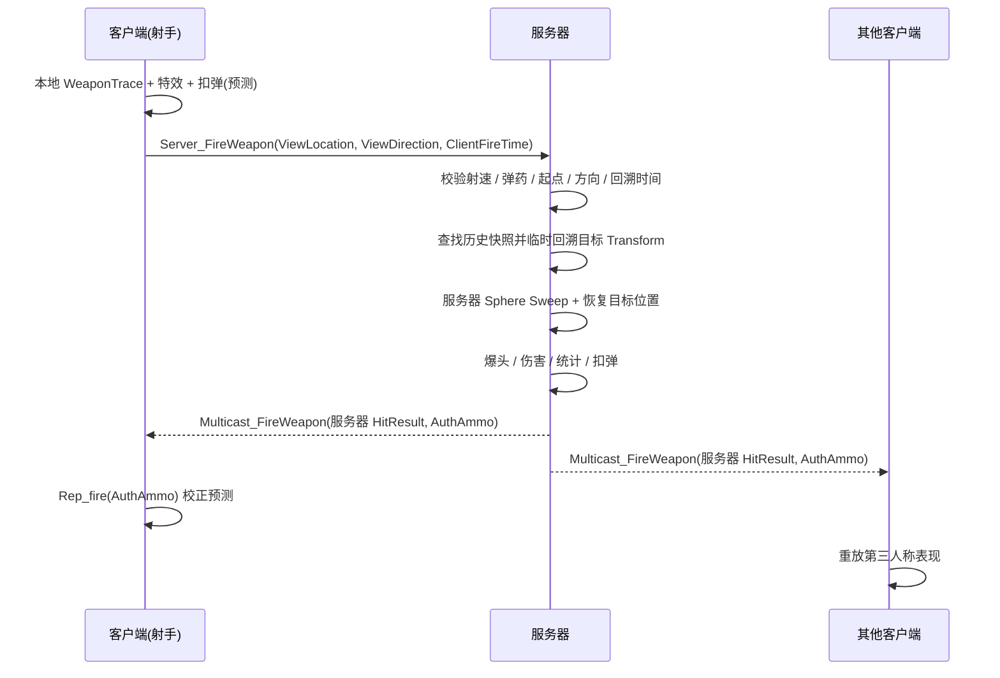

# FPS · UE5 多人联机第一人称射击

基于 **Unreal Engine 5.8 + C++** 的多人联机 FPS：战斗、击杀计分、UI 与局域网联机。
演示视频:  https://www.bilibili.com/video/BV1tHnc6zEd5/?share_source=copy_web&vd_source=92f3e22dd322afd6c14ab4ea29c7b8fb
可游玩 Demo: https://pan.baidu.com/s/16UytfZ1hihGHMDvZTcQauQ?pwd=mwrd 提取码: mwrd

`C++` · `网络同步` · `客户端预测` · `服务器权威` · `延迟补偿` · `Enhanced Input` · `UMG`

## 技术亮点

### 1) 多人网络同步：客户端预测 + 服务器权威

开火在客户端本地预测（球形扫掠 / 特效 / 扣除弹药），但客户端只向服务器上报开火意图，不发送命中结果：

- 客户端 → 服务器：`ViewLocation`、`ViewDirection`、`ClientFireTime`
- 服务器：校验射速、弹药、开火起点、方向和回溯时间
- 服务器：回溯目标历史位置并执行服务器 Sweep
- 服务器：结算伤害、爆头、统计并 Multicast 表现
- 射手客户端：`Rep_fire` 对账弹药
- 其他客户端：用服务器 `HitResult` 重放第三人称表现

### 2) 服务端延迟补偿：历史快照 + 目标回溯

- 服务器在 `PostPhysics` 阶段为每个玩家记录历史快照，仅保存 `TimeSeconds + ActorTransform`
- 使用 `TDeque` 保存最近 1 秒、最多 120 个快照；死亡 / 重生时清空
- 收到开火请求后，按 `ClientFireTime` 找到目标最接近的历史位置
- 临时将目标 `SetActorTransform` 回溯到历史位置，执行服务器 `Sphere Sweep`，随后立即恢复
- 爆头通过服务器 Mesh Sweep 返回的 `BoneName == "head"` 判断
- Dedicated Server 下强制 3P Mesh 使用 `AlwaysTickPoseAndRefreshBones`，避免未渲染时 Physics Asset 碰撞姿态滞后
- 武器射程和扫掠半径由 `AWeapon` 配置，客户端预测和服务器回溯使用同一组参数

> 当前快照只回溯 `ActorTransform`，不回溯骨骼姿态；后续可扩展关键 Hitbox 快照或插值来提升肢体精度。

### 3) 服务器权威 + 反作弊

- 伤害 / 血量 / 弹药 / 统计均由**服务器计算与复制**，客户端无法越权改写
- 命中判定完全在服务器完成，客户端只上报开火位置、方向和服务器时间估计
- 开火校验：
  - 射速上限
  - 武器与弹药状态
  - 开火起点与服务器眼位距离（默认 20cm）
  - 开火方向与服务器控制旋转夹角（默认 10°）
  - 回溯时间必须落在 0.5 秒窗口内，非法时使用 Ping/2 兜底
- 爆头使用服务器 Sweep 返回的骨骼名，不采信客户端上报的 `BoneName`
- 换弹仍由服务器校验 `Reloading` 状态，防止重复触发刷弹

### 4) 特殊击杀系统（位掩码事件）

一次击杀可同时触发多种特殊事件（爆头 / 连杀 / 复仇 / 首杀 / 领先…），用 `uint16` **位掩码打包进单个 RPC**，客户端解码后按队列逐个弹窗——**状态用复制、事件用 RPC**，省带宽且时序可控。

### 5) UI 系统（数据驱动 + 表现）

- **准星**：武器动态材质 + 多因子（开火 / 瞄准 / 锁定目标）在 Tick 中插值，锁定玩家时变红；
- **特殊击杀弹窗**：位掩码解码 → `TQueue` 队列 → 定时器逐个串行弹出，文案 / 图标取自 DataAsset；
- **计分板**：按 `PlayerState` 数组动态生成行、本人行高亮、0.5s刷新一次，按住 Tab 显隐；
- **Ping / 备弹 / 比分**：与组件 / `PlayerState` 的委托绑定并定时刷新。

## 网络验证

- `Play As Client` + 多客户端测试 Dedicated Server
- `Net PktLag=150` / `Net PktLagVariance=50` 模拟延迟
- `LagCompensationComponent::bDrawDebug` 查看回溯射线
- `AWeapon::bShowDebugSphereTrace` 查看客户端武器扫掠

## 其他

局域网 Host/Join 联机菜单 · 原地转身 / FABRIK 左手 IK / 换弹动画通知驱动逻辑

## 技术栈

UE 5.8 · C++ · Enhanced Input · UMG · GameplayTags · DX12 / Lumen / VSM

## 提示
鼠标右键瞄准
E键切换武器
R键换弹
ctrl键下蹲
空格键跳跃
按住Tab键打开计分板
如果不输入名字默认则是player1，player2 ~ PlayerN...

如果游戏闪退则创建快捷方式通过 dx11 启动

## 文档

详细架构与实现说明 → [PROJECT.md](PROJECT.md)

## 联系

- 邮箱：<1619433745@qq.com>
