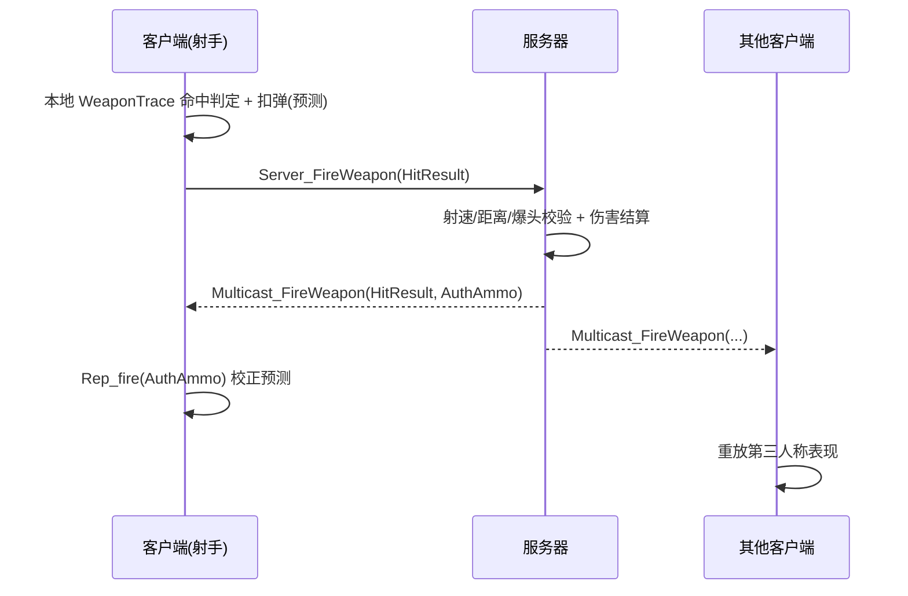

# FPS · UE5 多人联网第一人称射击

基于 **Unreal Engine 5.8 + C++** 的多人联网 FPS：战斗、淘汰计分、UI 与局域网联机。

`C++` · `网络同步` · `客户端预测` · `服务器权威` · `Enhanced Input` · `UMG`

## 技术亮点

### 1) 多人网络同步：客户端预测 + 服务器仲裁

开火在客户端本地预测（射线判定 / 特效 / 扣弹），服务器校验后结算伤害并广播，客户端回拉对账，兼顾手感与一致。

### 2) 服务器权威 + 反作弊

- 伤害 / 血量 / 弹药 / 统计均由**服务器计算与复制**，客户端无法越权改写；
- 服务器校验开火请求：**射速上限、命中距离、爆头骨骼、换弹时序**；
- 关键入口加 `HasAuthority` 断言，客户端调用无效。

### 3) 特殊淘汰系统（位掩码事件）

一次击杀可同时触发多种特殊事件（爆头 / 连杀 / 复仇 / 首杀 / 领先…），用 `uint16` **位掩码打包进单个 RPC**，客户端解码后按队列逐个弹窗——**状态用复制、事件用 RPC**，省带宽且时序可控。

### 4) UI 系统（数据驱动 + 表现）

- **准星**：武器动态材质 + 多因子（开火 / 瞄准 / 锁定目标）在 Tick 中插值，锁定玩家时变红；
- **特殊淘汰弹窗**：位掩码解码 → `TQueue` 队列 → 定时器逐个串行弹出，文案 / 图标取自 DataAsset；
- **计分板**：按 `PlayerState` 数组动态生成行、本人行高亮、按住 Tab 显隐；
- **Ping / 备弹 / 比分**：与组件 / `PlayerState` 的委托绑定并定时刷新。

## 其他

Enhanced Input（按住 Tab 计分板）· 局域网 Host/Join 联机菜单 · 原地转身 / FABRIK 左手 IK / 换弹动画通知驱动逻辑

## 技术栈

UE 5.8 · C++ · Enhanced Input · UMG · GameplayTags · DX12 / Lumen / VSM

## 快速开始

- 环境：Unreal Engine 5.8 + Visual Studio（MSVC）
- 构建：`Build.bat FPSEditor Win64 Development -Project=<项目路径>\FPS.uproject`
- 联机自测：PIE `Play As Listen Server`；验证服务器权威逻辑用 `Play As Client`
- 延迟测试：客户端控制台 `Net PktLag=200`

## 文档

详细架构与实现说明 → [PROJECT.md](PROJECT.md)

## 联系

- GitHub：@<你的ID>
- 邮箱：<你的邮箱>
